# Instalacja Ludius MS — krok po kroku

> **Dla kogo jest ten poradnik?**  
> Dla osoby, która pierwszy raz stawia serwer w Oracle Cloud. Nie musisz wcześniej znać Linuksa, Dockera, Tailscale ani Jellyfin. Rób kroki po kolei i nie pomijaj ostrzeżeń.

> **Status projektu:** Ludius MS nadal jest buildem testowym. Instalator był sprawdzany na czystym Ubuntu 24.04 LTS i na Oracle Cloud, ale nadal może zawierać błędy. Nie używaj dysku z ważnymi danymi.

---

## Co zrobimy

W całym poradniku:

1. utworzymy darmową instancję w Oracle Cloud,
2. dodamy osobny dysk na filmy, seriale i anime,
3. połączymy się z serwerem przez SSH,
4. pobierzemy Ludius MS z GitHuba,
5. uruchomimy graficzny instalator,
6. połączymy serwer z Tailscale,
7. sprawdzimy dashboard, Jellyfin i qBittorrent.

Na spokojnie — większość pracy wykona instalator.

---

# Część 1 — serwer w Oracle Cloud

Na początek wejdź na stronę Oracle Cloud:

**https://cloud.oracle.com/**

Jeśli nie masz jeszcze konta Oracle Cloud, załóż je i zaloguj się do panelu.

## 1. Wejdź do Compute → Instances

W Oracle Cloud otwórz menu po lewej stronie:

**Compute → Instances**

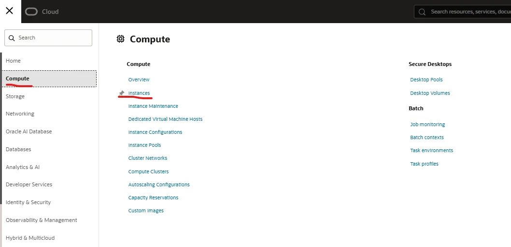

Kliknij **Create instance**.

---

## 2. Wybierz Ubuntu i darmowy typ maszyny

W sekcji systemu wybierz:

- **Canonical Ubuntu 24.04**
- typ maszyny: **Virtual machine**
- seria procesora: **Ampere**
- shape: **VM.Standard.A1.Flex**
- wybierz wariant oznaczony jako **Always Free-eligible**

Na potrzeby Ludius MS wystarczy konfiguracja podobna do tej ze screena:

- **2 OCPU**
- **12 GB RAM**

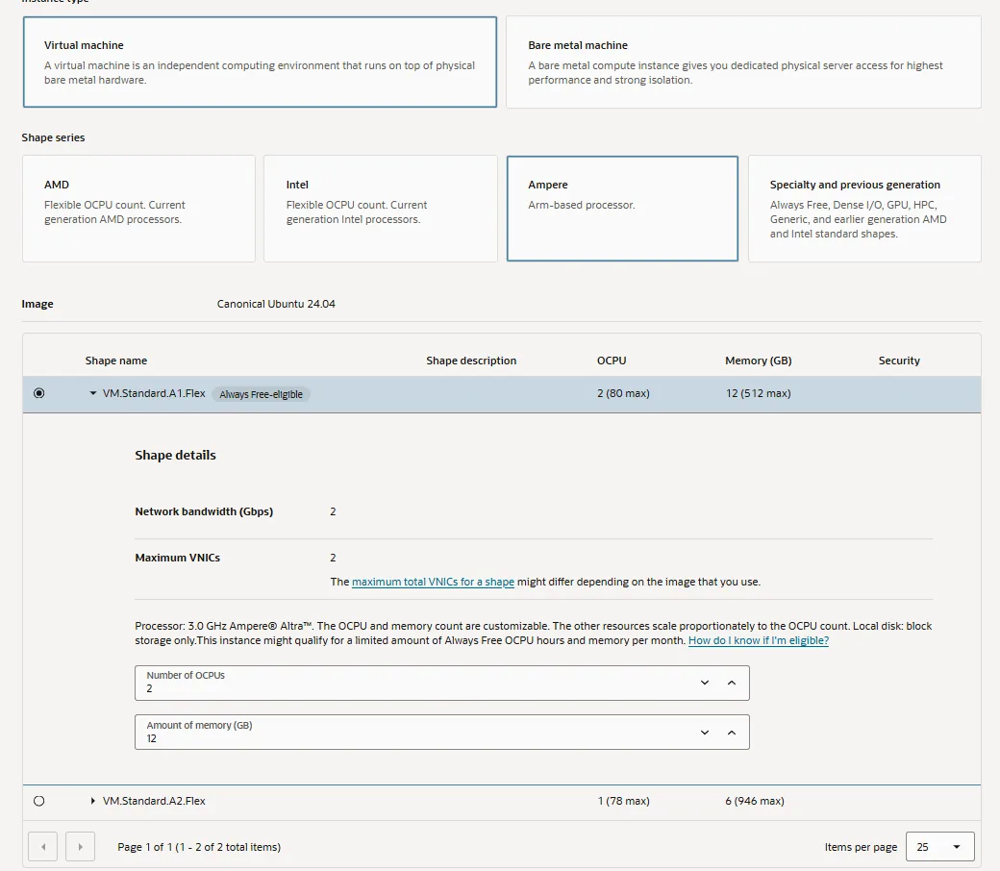

> **Ważne:** patrz na oznaczenie **Always Free-eligible**. Nie wybieraj płatnego wariantu tylko dlatego, że wygląda podobnie.

Systemowy dysk startowy zostaw na domyślnej wartości, jeśli Oracle pokazuje około **50 GB**.

---

## 3. Ustaw sieć

Jeśli to Twoja pierwsza instancja, najłatwiej pozwolić Oracle utworzyć sieć automatycznie.

W sekcji **Networking** ustaw:

- **Create new virtual cloud network**
- **Create new public subnet**
- prywatny adres IPv4: **Automatically assign private IPv4 address**
- IPv6 możesz zostawić wyłączone

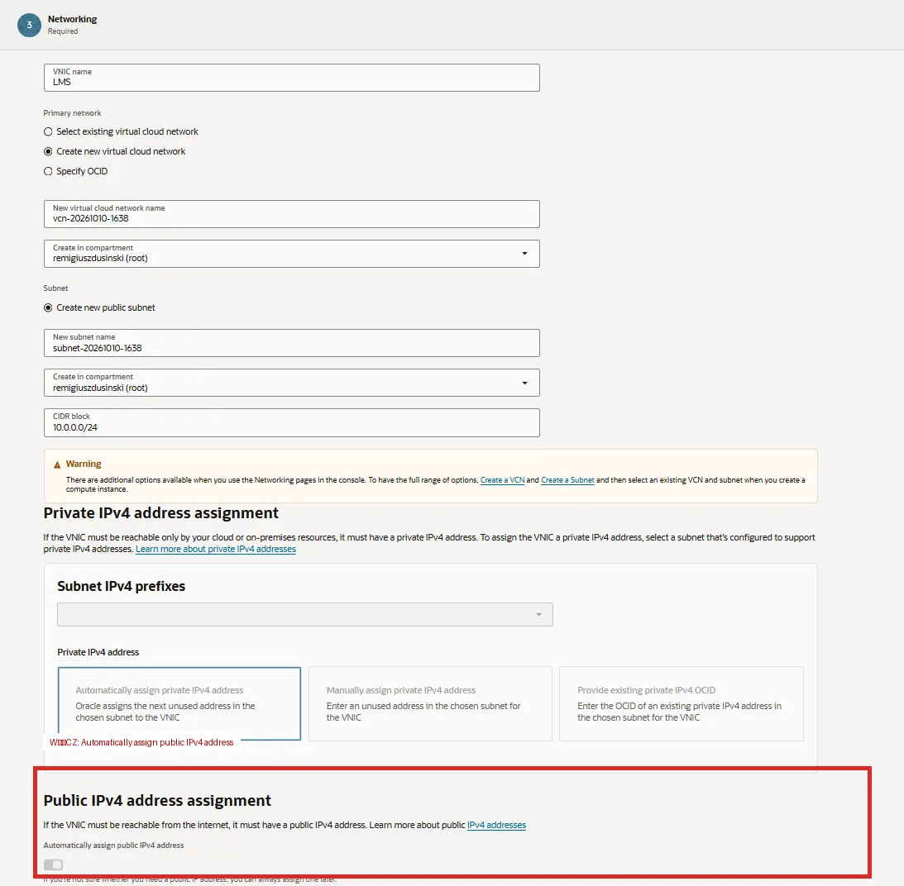

Na tym ekranie opcja **Automatically assign public IPv4 address** może być wyszarzona i nie dać się włączyć. **To normalne — zostaw ją tak, jak jest.**

Publiczny adres IPv4 przypiszemy chwilę później, już po utworzeniu instancji. Będzie potrzebny tylko do pierwszego połączenia SSH. Po instalacji będziemy korzystać z prywatnego Tailscale.

---

## 4. Pobierz klucz SSH

W sekcji **Add SSH keys** najprościej zaznacz:

**Generate a key pair for me**

Następnie kliknij:

**Download private key**

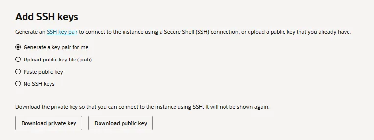

Zapisz plik w bezpiecznym miejscu. Oracle nie pokaże Ci ponownie tego samego klucza prywatnego.

Na Windows możesz na przykład utworzyć folder:

```text
C:\Users\TWOJA_NAZWA\.ssh\
```

i przenieść tam pobrany klucz, np. jako:

```text
ludius.key
```

Nie wysyłaj tego pliku nikomu i nie dodawaj go do GitHuba.

Nie klikaj jeszcze **Create** — najpierw ustawimy dysk systemowy.

---

## 5. Ustaw dysk systemowy (Boot volume)

Przewiń niżej do sekcji **Storage → Boot volume**.

Włącz:

**Specify a custom boot volume size and performance setting**

Następnie ustaw:

- **Boot volume size:** `50 GB`
- **Boot volume performance:** `10 VPU`
- **Use in-transit encryption:** włączone
- **Encrypt this volume with a key that you manage:** wyłączone

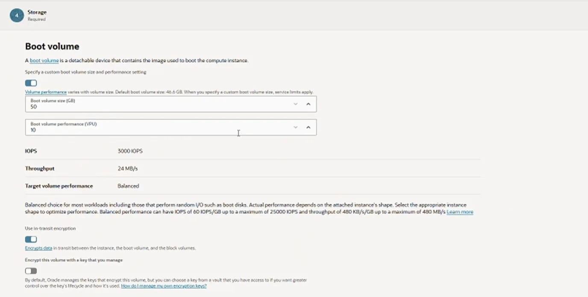

To jest dysk systemowy serwera. Będzie na nim Ubuntu oraz pliki potrzebne do działania Ludius MS. Multimedia będą przechowywane osobno na Block Volume, który utworzymy w następnym kroku.

Pozostałe ustawienia możesz zostawić domyślne.

Teraz kliknij **Create** i poczekaj, aż instancja będzie miała status **Running**.

---

# Część 2 — dysk na multimedia

Ludius MS trzyma multimedia na **osobnym Block Volume**. Dzięki temu system i Twoje pliki są rozdzielone.

## 6. Otwórz Block Volumes

W menu Oracle wybierz:

**Storage → Block Volumes**

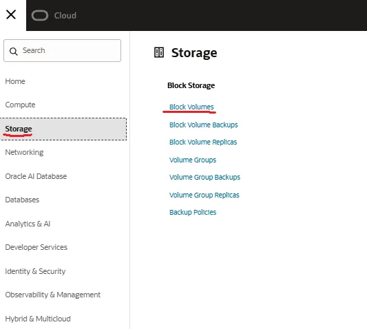

Kliknij **Create Block Volume**.

---

## 7. Utwórz dysk `LMS-Media`

Ustaw:

- nazwa: `LMS-Media`
- **Availability Domain:** taki sam jak przy instancji
- **Custom**
- rozmiar: `150 GB`
- **VPUs type:** `0 VPUs/GB (Lower cost)`
- auto-tune: wyłączone

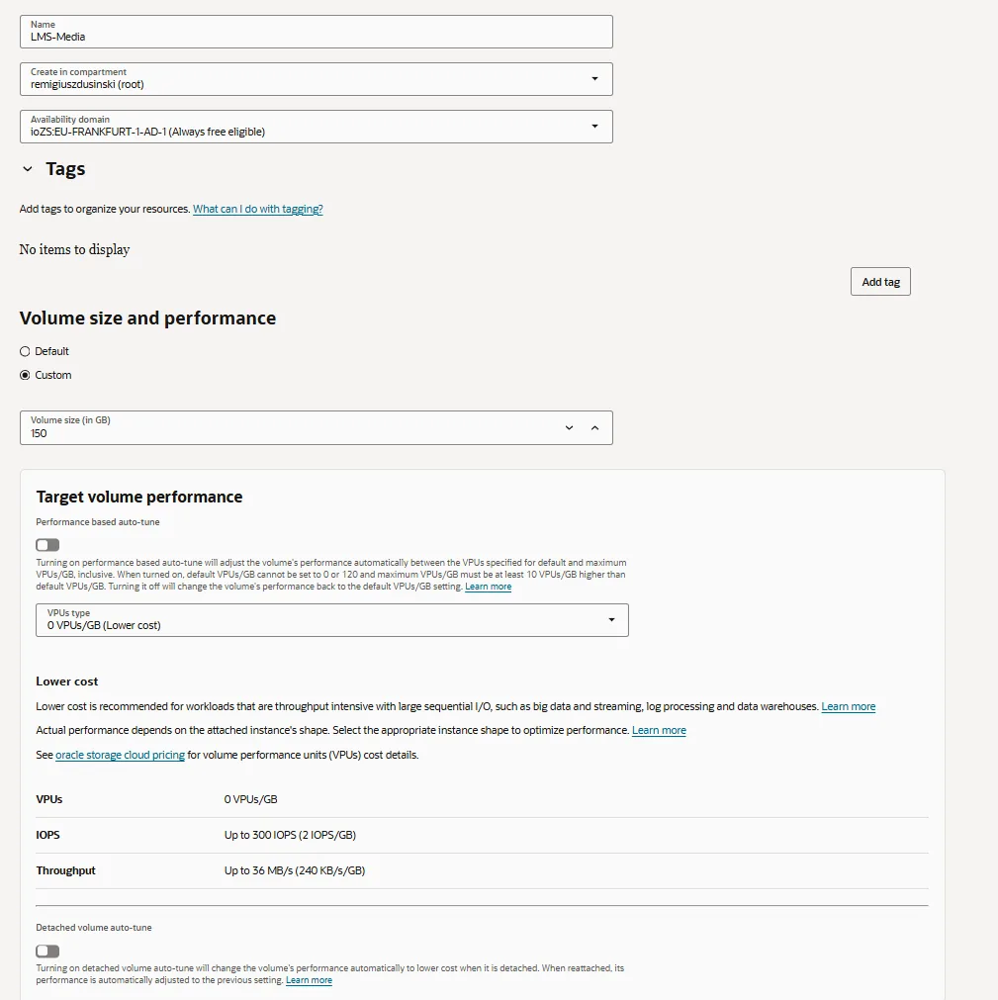

### Dlaczego 150 GB?

Oracle Always Free obejmuje obecnie **200 GB łącznie** dla boot volume i block volume w regionie domowym. Jeśli Twoja instancja ma domyślny dysk systemowy 50 GB i nie wykorzystujesz limitu na inne wolumeny, zostaje 150 GB na `LMS-Media`.

> **Sprawdź podsumowanie kosztów przed kliknięciem Create.** Limity Oracle mogą się zmienić, a posiadanie innych dysków na koncie zmniejsza dostępną darmową pulę.

`Lower cost` jest dobrym wyborem do przechowywania i strumieniowania dużych plików multimedialnych.

Kliknij **Create Block Volume**.

---

## 8. Podepnij dysk do instancji

Wróć do:

**Compute → Instances → Twoja instancja**

Otwórz zakładkę **Storage**.

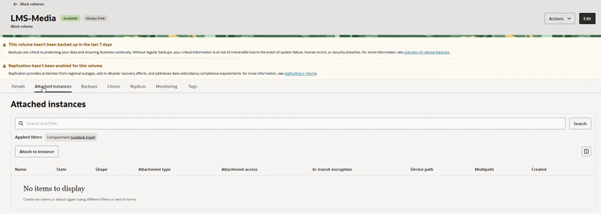

Znajdź **Attached block volumes** i kliknij **Attach Block Volume**.

W oknie wybierz:

- Block Volume: `LMS-Media`
- Attachment type: **Paravirtualized** / **Recommended**
- Access: **Read/Write**

Kliknij **Attach**.

Po chwili status powinien zmienić się na **Attached**.

Nie formatuj dysku ręcznie. Zrobi to instalator Ludius MS.

---

# Część 3 — pierwsze połączenie z serwerem

## 9. Przypisz publiczny adres IPv4

Po utworzeniu instancji publiczny adres IPv4 może jeszcze nie być przypisany. Zrobimy to teraz.

W Oracle wejdź w:

**Compute → Instances → Twoja instancja → Networking**

W sekcji **Attached VNICs** kliknij główny VNIC instancji.

Następnie otwórz zakładkę **IP administration**. Przy głównym prywatnym adresie IP kliknij menu z trzema kropkami **⋮** i wybierz **Edit**.

W polu **Public IP type** wybierz:

**Ephemeral public IP**

i zatwierdź przyciskiem **Update**.

Po chwili Oracle przypisze instancji publiczny adres IPv4. Skopiuj go — będzie potrzebny do pierwszego połączenia SSH.

Przykładowo może wyglądać tak:

```text
123.45.67.89
```

To tylko przykład. Użyj adresu swojej instancji.

---

## 10. Połącz się przez PowerShell

Na Windows otwórz **PowerShell**.

Jeśli Twój klucz jest zapisany jako:

```text
C:\Users\TWOJA_NAZWA\.ssh\ludius.key
```

połącz się poleceniem:

```powershell
ssh -i "$env:USERPROFILE\.ssh\ludius.key" ubuntu@TWOJ_PUBLICZNY_IP
```

Przykład:

```powershell
ssh -i "$env:USERPROFILE\.ssh\ludius.key" ubuntu@123.45.67.89
```

Przy pierwszym połączeniu SSH może zapytać:

```text
Are you sure you want to continue connecting?
```

Wpisz:

```text
yes
```

i naciśnij Enter.

Jeżeli zobaczysz terminal z nazwą serwera, jesteś już zalogowany do Ubuntu.

---

# Część 4 — pobranie Ludius MS

## 11. Przygotuj system

W terminalu serwera skopiuj i wklej:

```bash
sudo apt update
sudo apt install -y git python3 curl ca-certificates util-linux
```

Poczekaj, aż polecenia się zakończą.

---

## 12. Pobierz Ludius MS i zbuduj instalator

Skopiuj cały blok:

```bash
git clone https://github.com/Ludius100/ludiusms.git
cd ludiusms

python3 installer/build_bundle.py \
  --installer-source installer \
  --api-source dashboard-api \
  --homepage-source homepage \
  --output build/ludius-ms

cd build/ludius-ms
sha256sum -c MANIFEST.sha256
```

Po sprawdzeniu manifestu przy plikach powinno pojawić się `OK`.

Teraz uruchom instalator:

```bash
sudo ./install.sh --local
```

Terminal pokaże adres podobny do:

```text
http://127.0.0.1:8765/?token=...
```

> **Nie wysyłaj nikomu tego adresu ani tokenu.** Token daje dostęp do konfiguracji instalatora.

Nie zamykaj tego terminala.

---

# Część 5 — otwarcie instalatora w przeglądarce

## 13. Otwórz drugi PowerShell

Na swoim komputerze uruchom **drugie okno PowerShell**.

Wpisz:

```powershell
ssh -i "$env:USERPROFILE\.ssh\ludius.key" -N -L 8765:127.0.0.1:8765 ubuntu@TWOJ_PUBLICZNY_IP
```

Po wpisaniu komendy okno może wyglądać tak, jakby się zawiesiło i nic nie robiło.

**To jest prawidłowe.** Tunel SSH działa, dopóki to okno pozostaje otwarte.

Teraz skopiuj **pełny adres z tokenem**, który pokazał instalator w pierwszym terminalu, i otwórz go w przeglądarce.

---

# Część 6 — graficzny instalator Ludius MS

## 14. Serwer

Pierwszy ekran pokazuje, co instalator wykrył na serwerze.

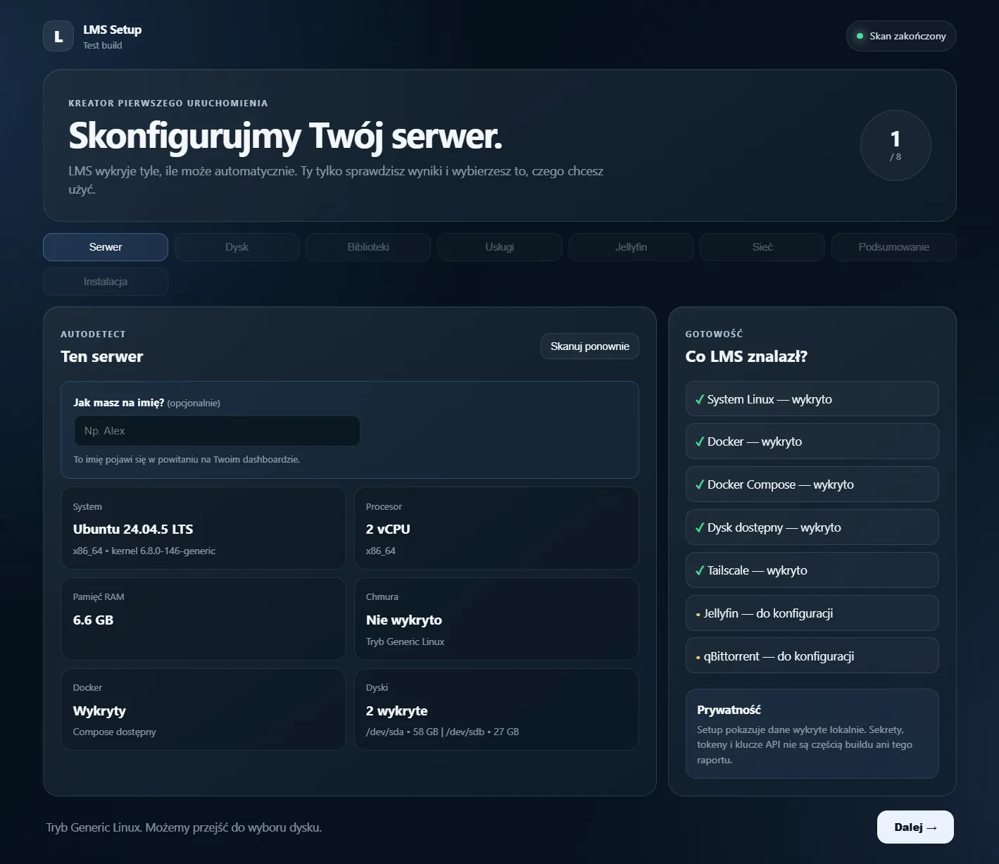

Możesz wpisać swoje imię. Pojawi się ono później w powitaniu na dashboardzie.

Na świeżej instancji część pozycji może mieć inny status niż na screenie. Na przykład Docker albo Tailscale mogą nie być jeszcze zainstalowane. To normalne.

Kliknij **Dalej**.

---

## 15. Dysk

Instalator pokaże dostępne urządzenia.

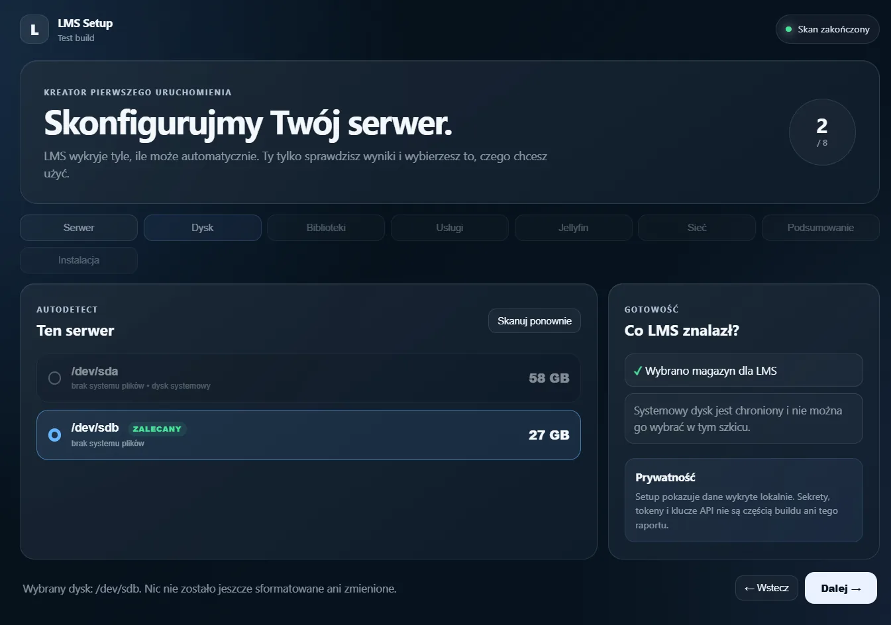

Wybierz **dodatkowy Block Volume**, który utworzyliśmy wcześniej.

Nie sugeruj się ślepo nazwą `/dev/sdb` ze screena. Na Twojej instancji nazwa może być inna.

Najłatwiej rozpoznać poprawny dysk po rozmiarze — powinien mieć około **150 GB**.

> **UWAGA: WYBRANY DYSK ZOSTANIE SFORMATOWANY. WSZYSTKIE DANE NA NIM ZOSTANĄ USUNIĘTE.**

Instalator chroni dysk systemowy, ale i tak sprawdź rozmiar przed przejściem dalej.

Kliknij **Dalej**.

---

## 16. Biblioteki

Wybierz, co chcesz przechowywać:

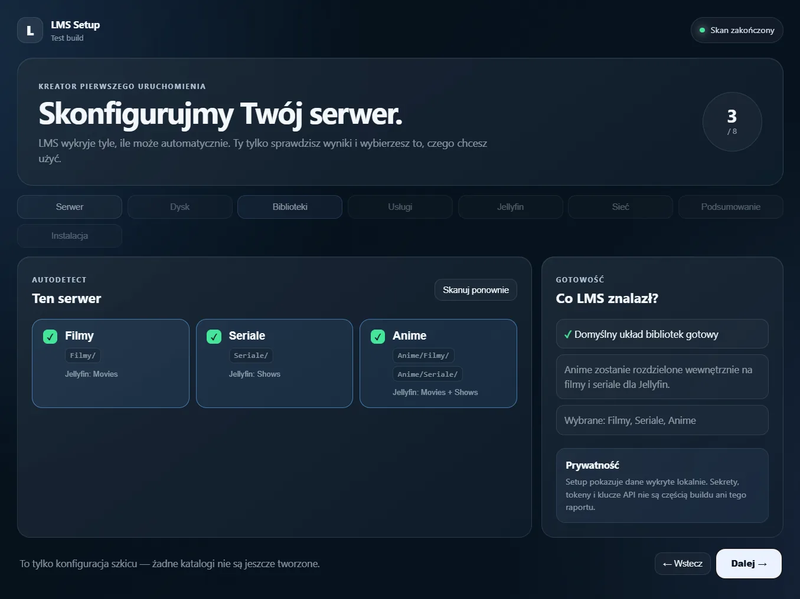

Domyślnie możesz zostawić:

- Filmy
- Seriale
- Anime

Dla Anime LMS utworzy osobne katalogi na filmy i seriale.

Kliknij **Dalej**.

---

## 17. Usługi

Na tym ekranie wybierasz usługi LMS.

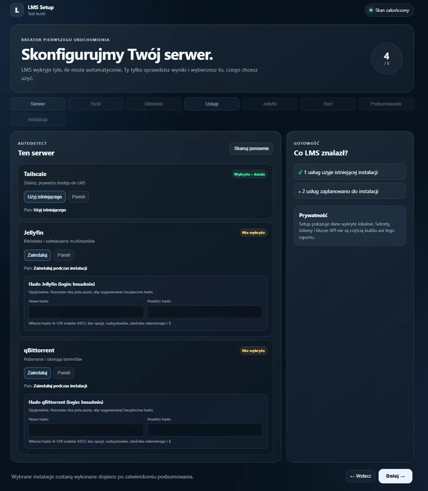

Zalecany zestaw:

- **Tailscale**
- **Jellyfin**
- **qBittorrent**

Przy Jellyfin i qBittorrent możesz wpisać własne hasła.

Jeżeli zostawisz pola puste, Ludius MS wygeneruje silne hasła automatycznie i pokaże je po zakończeniu instalacji.

Na świeżej instancji Tailscale może być oznaczony jako niewykryty. To normalne — instalator przeprowadzi Cię przez jego konfigurację.

Kliknij **Dalej**.

---

## 18. Jellyfin i napisy

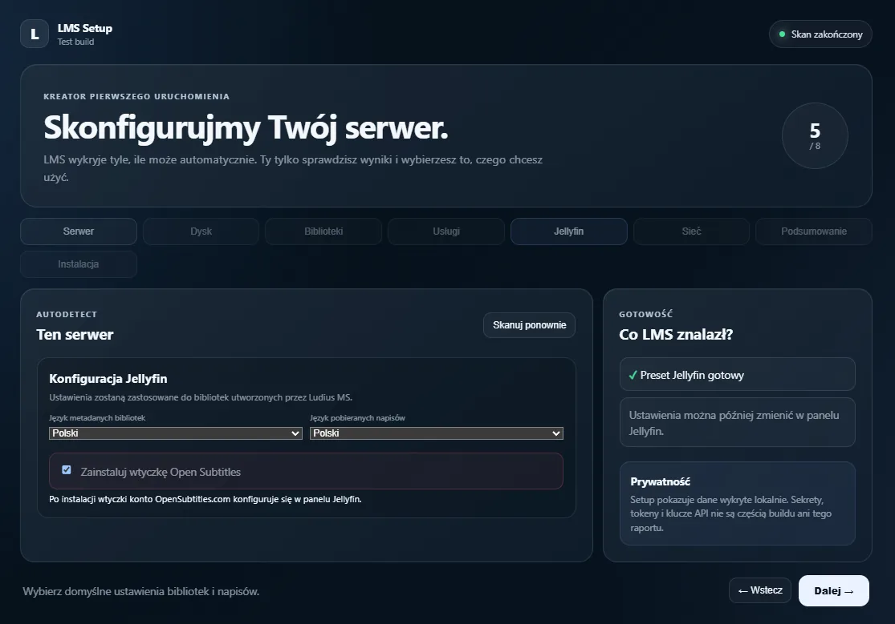

Dla polskiej biblioteki możesz ustawić:

- język metadanych: **Polski**
- język napisów: **Polski**
- **Zainstaluj wtyczkę Open Subtitles** — zaznaczone

Konto OpenSubtitles dodasz później w samym Jellyfin.

Kliknij **Dalej**.

---

## 19. Sieć — wybierz Tailscale

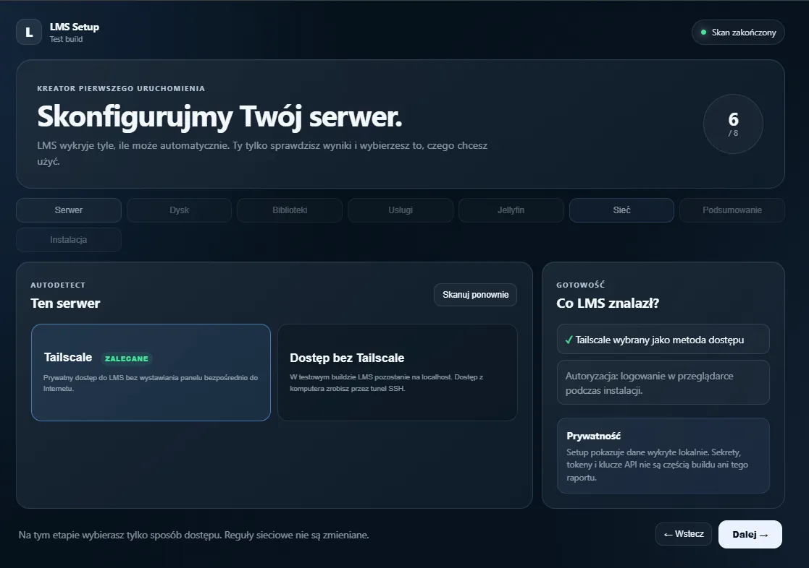

Wybierz **Tailscale**.

Tailscale tworzy prywatne połączenie między Twoim komputerem a serwerem. Dzięki temu nie musisz wystawiać dashboardu, Jellyfin ani qBittorrenta bezpośrednio do Internetu.

Kliknij **Dalej**.

---

## 20. Sprawdź podsumowanie

Instalator pokaże cały plan.

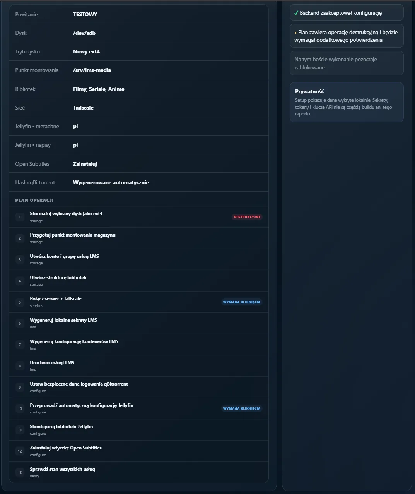

Sprawdź przede wszystkim:

- wybrany dysk,
- punkt montowania `/srv/lms-media`,
- biblioteki,
- Tailscale,
- język Jellyfin,
- Open Subtitles.

Operacja formatowania dysku jest oznaczona jako **DESTRUKCYJNA**.

Jeżeli wszystko się zgadza, przejdź dalej.

---

## 21. Ostatnie potwierdzenie

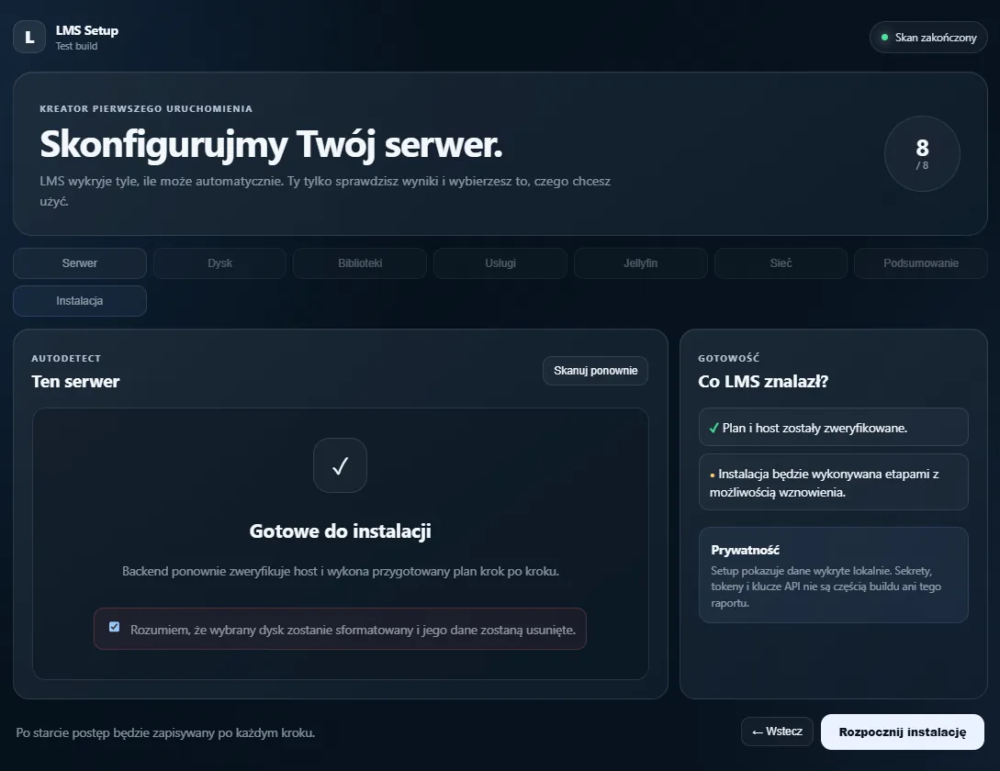

Zaznacz:

**Rozumiem, że wybrany dysk zostanie sformatowany i jego dane zostaną usunięte.**

Następnie kliknij:

**Rozpocznij instalację**

---

## 22. Poczekaj na instalację

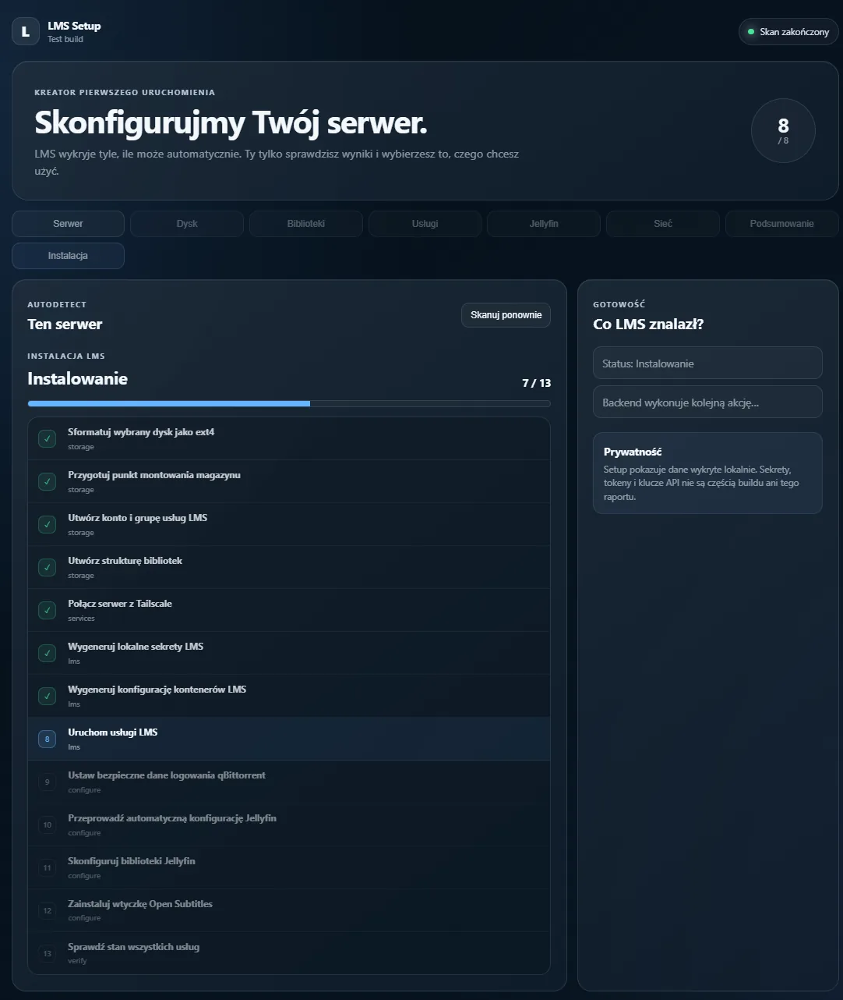

LMS wykonuje wszystkie kroki po kolei.

Nie zamykaj:

- strony instalatora,
- pierwszego terminala SSH,
- PowerShella z tunelem.

### Połączenie z Tailscale odbywa się podczas instalacji

W trakcie instalacji LMS zatrzyma się na kroku Tailscale i pokaże przycisk **Otwórz autoryzację**.

Kliknij go, zaloguj się w przeglądarce do swojego konta Tailscale i zaakceptuj dodanie serwera.

Następnie wróć do instalatora i kliknij **Wznów**.

Od tego momentu Tailscale na serwerze jest już skonfigurowany. Po zakończeniu instalacji **nie trzeba konfigurować go ponownie**.

Jeśli chcesz otwierać LMS z Windowsa, zainstaluj aplikację Tailscale na swoim komputerze (jeżeli jeszcze jej nie masz) i zaloguj się na **to samo konto**.

---

## 23. Zapisz dane logowania

Po udanej instalacji zobaczysz ekran podobny do tego:

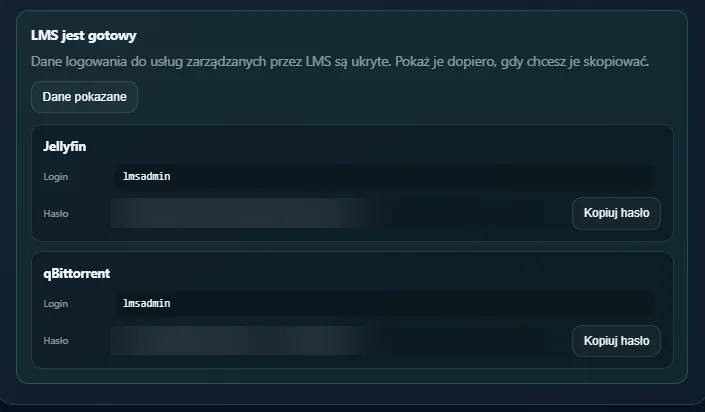

Instalator pokaże dane do:

- Jellyfin
- qBittorrent

**Zapisz hasła od razu w bezpiecznym miejscu.**

Na screenie w tym poradniku hasła zostały specjalnie zamazane.

---

# Część 7 — wejście do Ludius MS przez Tailscale

Tailscale został już zainstalowany i autoryzowany przez kreator podczas instalacji. Tutaj niczego więcej nie konfigurujesz — potrzebujemy tylko adresu serwera w sieci Tailscale.

## 24. Sprawdź adres Tailscale serwera

W terminalu serwera wpisz:

```bash
tailscale ip -4
```

Dostaniesz adres zaczynający się zwykle od `100.`.

Przykład:

```text
100.64.12.34
```

To prywatny adres Twojego serwera w Tailscale.

---

## 25. Otwórz dashboard

Na komputerze zalogowanym do tego samego Tailscale otwórz:

```text
http://ADRES_TAILSCALE:3000
```

Przykład:

```text
http://100.64.12.34:3000
```

Pozostałe usługi:

```text
Jellyfin:     http://ADRES_TAILSCALE:8096
qBittorrent:  http://ADRES_TAILSCALE:8080
```

Użyj danych logowania pokazanych przez instalator.

---

# Część 8 — OpenSubtitles

Jeśli podczas instalacji zaznaczyłeś wtyczkę Open Subtitles:

1. otwórz Jellyfin,
2. zaloguj się jako administrator,
3. przejdź do ustawień wtyczki Open Subtitles,
4. wpisz dane swojego konta OpenSubtitles.

Sama wtyczka jest instalowana przez LMS, ale konto trzeba podać ręcznie.

---

# Część 9 — test po instalacji

Po instalacji sprawdź:

- czy otwiera się dashboard Ludius MS,
- czy Jellyfin działa,
- czy qBittorrent działa,
- czy możesz przesłać plik,
- czy pobieranie torrenta pojawia się w zakładce Media,
- czy biblioteki Jellyfin są widoczne.

Na koniec zrestartuj serwer:

```bash
sudo reboot
```

Odczekaj około 1–2 minuty i ponownie spróbuj wejść przez adres Tailscale.

LMS, Docker i Tailscale powinny uruchomić się ponownie automatycznie.

---

# Najczęstsze problemy

## Nie mogę połączyć się przez SSH

Sprawdź:

- czy instancja ma status **Running**,
- czy używasz **Public IPv4 address**,
- czy login to `ubuntu`,
- czy wskazujesz poprawny klucz prywatny.

Przykład:

```powershell
ssh -i "$env:USERPROFILE\.ssh\ludius.key" ubuntu@TWOJ_PUBLICZNY_IP
```

---

## PowerShell z tunelem nic nie pokazuje

Tak ma być.

Polecenie:

```powershell
ssh -i "$env:USERPROFILE\.ssh\ludius.key" -N -L 8765:127.0.0.1:8765 ubuntu@TWOJ_PUBLICZNY_IP
```

pracuje w tle i utrzymuje tunel. Nie zamykaj tego okna podczas konfiguracji.

---

## Nie widzę dodatkowego dysku w instalatorze

W Oracle sprawdź:

**Compute → Instances → Twoja instancja → Storage → Attached block volumes**

`LMS-Media` musi mieć status **Attached**.

Jeżeli dopiero go podłączyłeś, odczekaj chwilę i kliknij **Skanuj ponownie** w instalatorze.

---

## Po instalacji nie otwiera się adres `100.x.x.x`

Sprawdź, czy:

- Tailscale działa na serwerze,
- Tailscale jest zainstalowany na Twoim komputerze,
- oba urządzenia są zalogowane na to samo konto.

Na serwerze:

```bash
tailscale status
```

---

## Zapomniałem haseł pokazanych po instalacji

Nie publikuj pliku `.env` ani sekretów LMS w internecie.

Jeżeli dopiero skończyłeś instalację, najlepiej od razu skopiuj dane z ekranu końcowego do menedżera haseł.

---

# Gotowe 🎉

Jeżeli dashboard działa przez Tailscale, Jellyfin widzi biblioteki, a po restarcie serwer wraca samodzielnie — podstawowa instalacja Ludius MS jest zakończona.

Aktualny stan projektu i plan dalszego rozwoju znajdziesz w [ROADMAP.md](ROADMAP.md).
